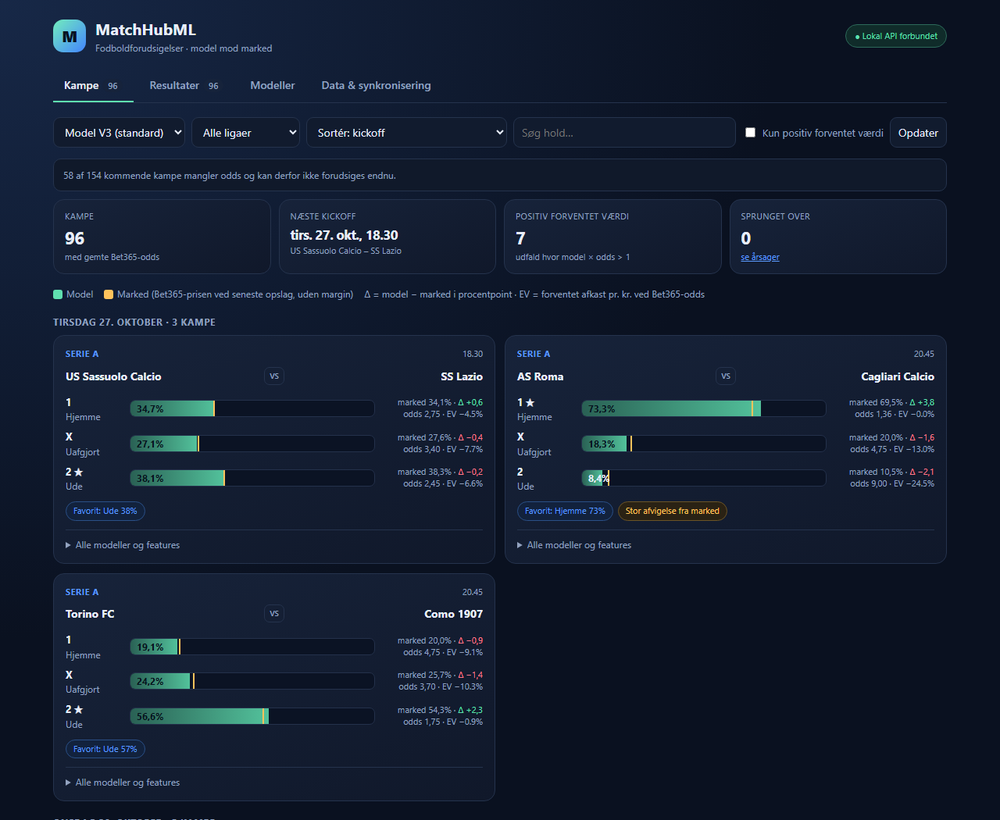
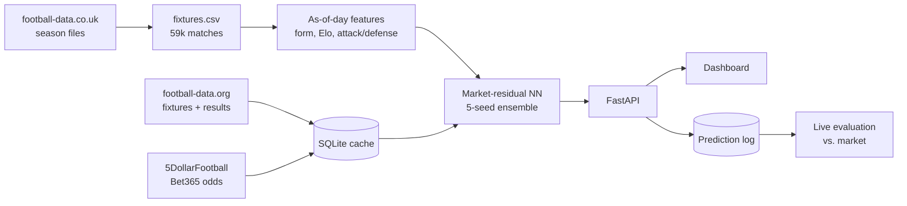

# MatchHubML

End-to-end football forecasting system for the top-5 European leagues. It collects
fixtures, results and Bet365 odds from free APIs, computes leak-free form and Elo
features, and predicts home/draw/away probabilities with a PyTorch model that
**learns corrections to the betting market** instead of re-learning it. A FastAPI
backend serves a dashboard and tracks every prediction against real results.



## Key result

Bookmaker odds are a very strong baseline: on 28,414 test matches, Bet365's odds
alone reach 53.7% accuracy. A plain neural network on 30 inputs (sports features +
odds) scored *below* that. Redesigning the model as
`logits = log(market) + correction(features)`, with the correction initialised to
zero (an untrained model *is* the market), fixed this:

| Model (walk-forward test, 28,414 matches) | Accuracy | Log loss |
|---|---|---|
| Bet365 odds alone | 53.72% | 0.96909 |
| Plain NN (v1 architecture, 5 seeds) | 53.41% | 0.97122 |
| **Market-residual NN (v3, 5 seeds)** | **53.64%** | **0.96876** |

Other ideas were tested the same way and rejected when they didn't beat the market:
rest days, promotion, shot form, league embeddings, recency weighting, Understat xG,
and Pinnacle odds (better market, but no longer available live).

## Architecture



- **Leak-free features**: every feature is computed from matches strictly before the
  match date (verified bit-for-bit against reference files and with leakage tests).
- **Fast**: the feature replay was rewritten from per-day pandas to plain Python and
  cached per day (27 s → 0.9 s first request, ~5 ms after).
- **Rate-limit aware sync**: plans API calls around free-tier quotas and shows how
  many presses remain to fetch missing odds.
- **Live tracking**: every pre-kickoff prediction is logged and scored against results.

## Run it

```bash
python -m venv .venv && .venv/Scripts/activate      # Linux/macOS: source .venv/bin/activate
pip install -r requirements.txt
cp .env.example .env                                 # add free API keys
uvicorn src.api:app                                   # open http://127.0.0.1:8000
```

Press *Synkronisér* / *Hent nyeste fil nu* in the Data tab to fetch fixtures, odds and
results. Retrain the model on new data with `python src/retrain_v3.py`.
Tests: `python -m unittest discover -s tests -t .` (also run by GitHub Actions).

## Repository layout

| Path | Contents |
|---|---|
| `src/` | App: API, data sync, features, models, training, prediction log |
| `tests/` | Unit tests (64) |
| `experiments/` | Backtests and experiments behind the model choices (run with `PYTHONPATH=src`) |
| `scripts/` | One-off tools and API probes |
| `models/` | Trained model artifacts (v1, v2, v3) |
| `matchhubml_frontend_live.html` | Dashboard (Danish UI) |

Stack: Python 3.12, PyTorch, pandas, scikit-learn, FastAPI, SQLite, vanilla JS.
